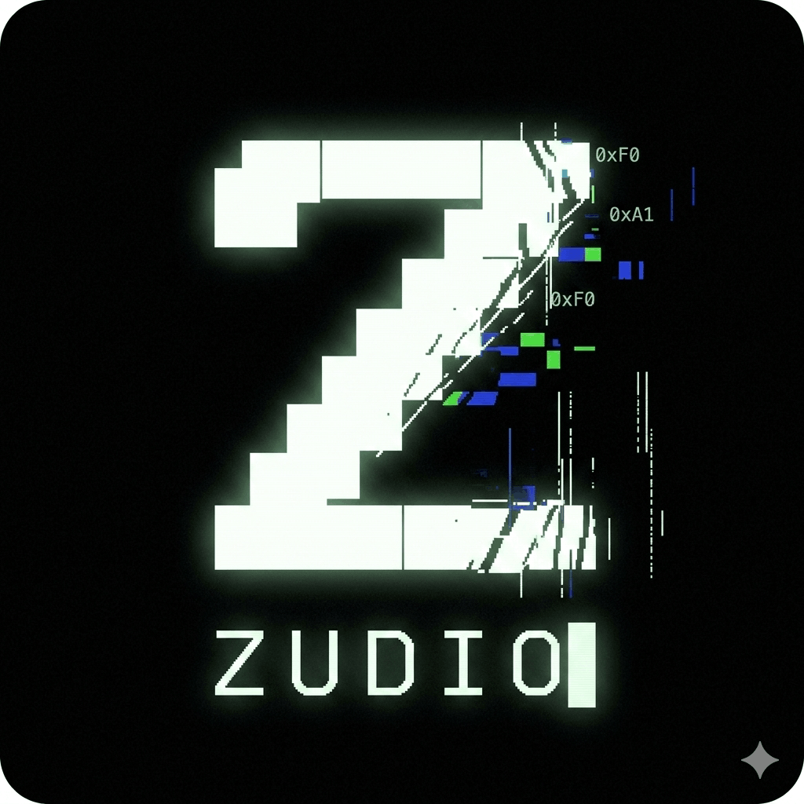

  

  <h1 align="center">
    
  </h1>

  

    
    
    
    
    
    
    
  

  
  

---

### ⚡ The Mission

I am an offensive security researcher focused on the intersection of **offensive security** and **automation**. My goal is to build tools that simplify the reconnaissance process and document the "how" and "why" of vulnerability research. I operate on a "learn in public" philosophy, turning CTF challenges into structured knowledge bases.

### 🛠️ Technical Arsenal

| Domain | Proficiency & Tooling |
| :--- | :--- |
| **Web Security** | Burp Suite, SQLi, XSS, IDOR, Auth Bypass, PortSwigger Academy |
| **Reconnaissance** | Python Automation, Amass, Nmap, Dig, Nikto, OSINT Frameworks |
| **Infrastructure** | Kali Linux (Host), VirtualBox Lab (Win 7/10/11), Bash Scripting |
| **Low-Level/Crypto** | Python, C++, Hashcat, Android APK Reversing, Cryptography |

### 📂 Featured Proof-of-Work

#### 🚀 [Zudio Recon Framework](https://github.com/zudio-infosec/zudio-recon-framework)
A multi-threaded offensive reconnaissance engine.
- **Impact**: Automates the first 4 hours of a pentest into a 5-minute report.
- **Tech**: Python, Multi-threading, Tool-orchestration.

#### 🚩 [The CTF Archive](https://github.com/zudio-infosec/ctf-writeups)
20 authorized writeups across PicoCTF, TryHackMe and the 2026 Cybersecurity Hackathon — web, network, crypto, Android reversing and DFIR.
- **Highlight**: 11 challenges solved in the 2026 Cybersecurity Hackathon.
- **Focus**: Turning raw flags into educational tutorials.

#### 🌐 [Portfolio](https://zudio-infosec.github.io)
The live site — writeups, tooling breakdowns, lab notes and OSINT write-throughs.
- **Stack**: Static HTML/CSS/JS, GitHub Actions, zero build step.

### 📈 Current Trajectory
- 🔭 **Focus**: Advanced Web App Pentesting & Red Team Automation.
- 📚 **Studying**: TryHackMe Level 2 Path & CEH methodologies.
- 🎯 **Objective**: Junior Offensive Security Internship (UK / Remote).

### 📫 Reach me
- **Email**: zudio001@proton.me
- **LinkedIn**: [hasham-javed](https://www.linkedin.com/in/hasham-javed-a03424400/)
- **TryHackMe**: [zudio.infosec](https://tryhackme.com/p/zudio.infosec)
- **Hack The Box**: [profile 1961817](https://www.hackthebox.com/profile/1961817)
- **Instagram**: [@zudio.infosec](https://www.instagram.com/zudio.infosec)
- **YouTube**: [@zudio-infosec](https://www.youtube.com/@zudio-infosec)

  

  

